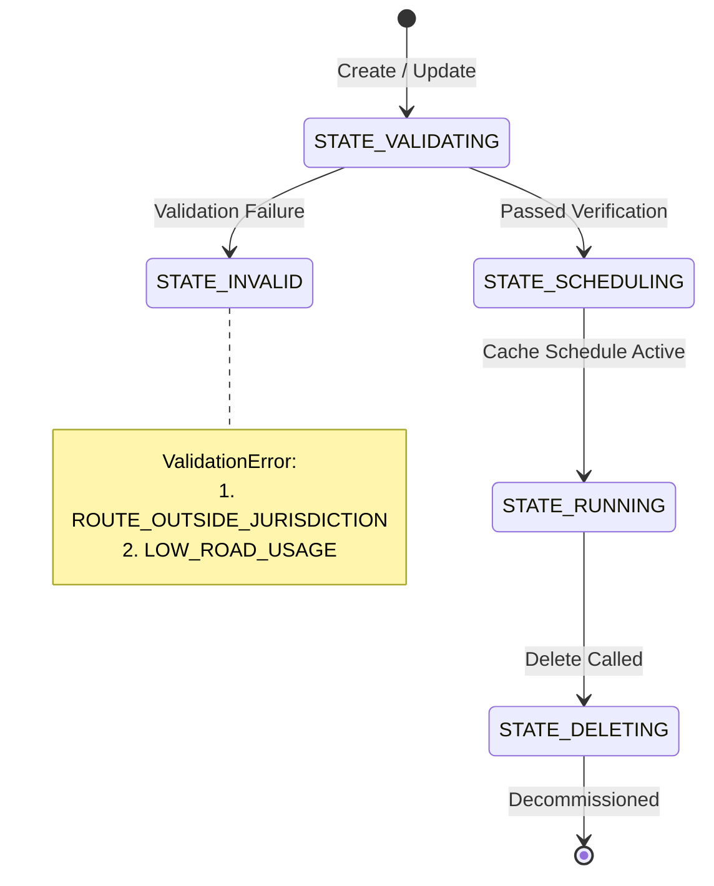

# Sample Code: Lifecycle State Tracking & Validation Error Diagnostics

This guide demonstrates how to monitor **`State`** lifecycle transitions and diagnose **`ValidationError`** causes for **`SelectedRoute`** resources in Roads Management Insights (RMI).

---

## 1. Lifecycle State Machine Architecture

When a route is created or updated, it transitions through several lifecycle stages before continuous traffic caching begins:



---

## 2. Enum Definitions & Error Reference

### `State` Enum Values (Output Only)

* **`STATE_UNSPECIFIED (0)`**: State has not been assigned.
* **`STATE_SCHEDULING (1)`**: Route passed validation; background telemetry workers are provisioning cache schedules.
* **`STATE_RUNNING (2)`**: Route has an active, continuous schedule emitting data to BigQuery and Pub/Sub.
* **`STATE_DELETING (3)`**: Route has been marked for asynchronous deletion and cleanup.
* **`STATE_VALIDATING (4)`**: Route geometry is undergoing spatial and traffic density verification.
* **`STATE_INVALID (5)`**: Route failed validation criteria (inspection of `validationError` is required).

### `ValidationError` Enum Values (Output Only when state is `STATE_INVALID`)

* **`VALIDATION_ERROR_ROUTE_OUTSIDE_JURISDICTION (1)`**:
  * *Cause*: One or more waypoints fall outside the territorial jurisdiction authorized for your GCP project.
  * *Remediation*: Adjust origin/destination coordinates to lie within contract boundaries.
* **`VALIDATION_ERROR_LOW_ROAD_USAGE (2)`**:
  * *Cause*: The requested corridor has insufficient aggregate vehicle volume to satisfy Google Maps privacy thresholds.
  * *Remediation*: Re-align route onto primary arterial or highway corridors.

### Synchronous Registration Failure (`HTTP 400 INVALID_ARGUMENT`) vs. Asynchronous `STATE_INVALID`

* **Asynchronous `STATE_INVALID`**: The route payload was accepted (`HTTP 200 OK`, initially `STATE_VALIDATING`), and background validation later flagged `ROUTE_OUTSIDE_JURISDICTION` or `LOW_ROAD_USAGE`.
* **Synchronous `HTTP 400 INVALID_ARGUMENT` (`"Request contains an invalid argument."`)**:
  * In addition to schema syntax errors, `CreateSelectedRoute` fails synchronously with `400 INVALID_ARGUMENT` when waypoints snap to the wrong carriageway of a divided highway (or a directionally closed segment) and generate cumulative turnaround loops exceeding ~150–180 km total routed distance.
  * **Pre-Flight Check**: Always verify candidate `[origin, ...intermediates, destination]` arrays against `POST https://routes.googleapis.com/directions/v2:computeRoutes` (`X-Goog-FieldMask: routes.distanceMeters,routes.legs.distanceMeters,routes.legs.steps.navigationInstruction.instructions`) to confirm total routed distance is within `1.0x–1.3x` of expected corridor length before calling `CreateSelectedRoute`.

---

## 3. Implementation Examples

### A. Polling for `STATE_RUNNING` with Automated Timeout (Shell)

```bash
#!/bin/bash
set -euo pipefail

source scripts/roadsselection_v1.sh
source scripts/roadsselection_v1_helpers.sh
source scripts/roadsselection_v1_util.sh

PROJECT_ID="my-roads-project"
ROUTE_ID="corridor-test-101"
ROUTE_NAME="projects/${PROJECT_ID}/selectedRoutes/${ROUTE_ID}"

# 1. Create a route
DYN_JSON=$(roadsselection_v1_dynamicroute_json 37.7749 -122.4194 37.7833 -122.4067 '[]')
ROUTE_JSON=$(roadsselection_v1_selectedroute_json "US-101 Verification Test" "${DYN_JSON}")

echo "Creating SelectedRoute '${ROUTE_ID}'..."
roadsselection_v1_selectedroute_create "${PROJECT_ID}" "${ROUTE_JSON}" "${ROUTE_ID}"

# 2. Wait for route to reach STATE_RUNNING (timeout: 60 seconds)
echo "Polling for route activation..."
if roadsselection_v1_selectedroute_wait_for_state "${ROUTE_NAME}" "STATE_RUNNING" 60; then
  echo "✅ Route is active and telemetry caching is running!"
else
  echo "❌ Route failed to reach STATE_RUNNING or entered STATE_INVALID."
  exit 1
fi
```

---

### B. Route Health Diagnostic Inspector (Python)

```python
import time
import google.auth
from google.auth.transport.requests import Request
import requests

VALIDATION_ERROR_MESSAGES = {
    "VALIDATION_ERROR_UNSPECIFIED": "No specific validation error details provided.",
    "VALIDATION_ERROR_ROUTE_OUTSIDE_JURISDICTION": "Route geometry falls outside your authorized project jurisdiction.",
    "VALIDATION_ERROR_LOW_ROAD_USAGE": "Route vehicle density is too low to satisfy Google privacy thresholds."
}

def inspect_route_health(project_id: str, route_id: str, timeout: int = 60) -> dict:
    """Polls SelectedRoute state and diagnoses validation errors."""
    credentials, _ = google.auth.default(scopes=["https://www.googleapis.com/auth/cloud-platform"])
    
    url = f"https://roads.googleapis.com/selection/v1/projects/{project_id}/selectedRoutes/{route_id}"
    start_time = time.time()

    while True:
        credentials.refresh(Request())
        headers = {
            "Authorization": f"Bearer {credentials.token}",
            "X-Goog-User-Project": project_id
        }
        res = requests.get(url, headers=headers)
        res.raise_for_status()
        data = res.json()

        state = data.get("state", "STATE_UNSPECIFIED")
        print(f"[{int(time.time() - start_time)}s] Current Route State: {state}")

        if state == "STATE_RUNNING":
            print(" Route is healthy and actively caching traffic telemetry.")
            return data

        if state == "STATE_INVALID":
            err = data.get("validationError", "VALIDATION_ERROR_UNSPECIFIED")
            desc = VALIDATION_ERROR_MESSAGES.get(err, "Unknown error")
            raise RuntimeError(f"❌ Route failed validation: {err} — {desc}")

        if time.time() - start_time > timeout:
            raise TimeoutError(f"Timed out waiting for route state after {timeout}s (Current: {state})")

        time.sleep(3)

if __name__ == "__main__":
    inspect_route_health("my-roads-project", "corridor-test-101")
```

---

### C. TypeScript (Node.js / State Poller & Error Handling)

```typescript
import { GoogleAuth } from 'google-auth-library';

const RouteState = {
  STATE_UNSPECIFIED: 'STATE_UNSPECIFIED',
  STATE_SCHEDULING: 'STATE_SCHEDULING',
  STATE_RUNNING: 'STATE_RUNNING',
  STATE_DELETING: 'STATE_DELETING',
  STATE_VALIDATING: 'STATE_VALIDATING',
  STATE_INVALID: 'STATE_INVALID',
} as const;
type RouteState = (typeof RouteState)[keyof typeof RouteState];

const ValidationError = {
  VALIDATION_ERROR_UNSPECIFIED: 'VALIDATION_ERROR_UNSPECIFIED',
  VALIDATION_ERROR_ROUTE_OUTSIDE_JURISDICTION: 'VALIDATION_ERROR_ROUTE_OUTSIDE_JURISDICTION',
  VALIDATION_ERROR_LOW_ROAD_USAGE: 'VALIDATION_ERROR_LOW_ROAD_USAGE',
} as const;
type ValidationError = (typeof ValidationError)[keyof typeof ValidationError];

interface RouteInspectionResult {
  name: string;
  state: RouteState;
  validationError?: ValidationError;
  createTime: string;
}

async function waitForRouteRunning(
  projectId: string,
  routeId: string,
  timeoutSeconds: number = 60
): Promise<RouteInspectionResult> {
  const auth = new GoogleAuth({
    scopes: ['https://www.googleapis.com/auth/cloud-platform'],
  });
  const url = `https://roads.googleapis.com/selection/v1/projects/${projectId}/selectedRoutes/${routeId}`;

  const startTime = Date.now();

  while (true) {
    const client = await auth.getClient();
    const tokenResponse = await client.getAccessToken();
    const accessToken = tokenResponse.token;

    const response = await fetch(url, {
      headers: {
        'Authorization': `Bearer ${accessToken}`,
        'X-Goog-User-Project': projectId,
      },
    });

    if (!response.ok) {
      throw new Error(`Failed to fetch route: ${response.statusText}`);
    }

    const data = (await response.json()) as RouteInspectionResult;

    if (data.state === RouteState.STATE_RUNNING) {
      return data;
    }

    if (data.state === RouteState.STATE_INVALID) {
      throw new Error(
        `Route entered ${data.state} with error: ${data.validationError ?? 'UNKNOWN'}`
      );
    }

    if ((Date.now() - startTime) / 1000 > timeoutSeconds) {
      throw new Error(`Timed out waiting for route ${routeId} to reach STATE_RUNNING (current: ${data.state})`);
    }

    await new Promise((resolve) => setTimeout(resolve, 3000));
  }
}

export { waitForRouteRunning, RouteState, ValidationError, type RouteInspectionResult };
```

---

### D. Direct REST Call (`curl`)

```bash
PROJECT_ID="my-roads-project"
ROUTE_ID="corridor-test-101"
ACCESS_TOKEN=$(gcloud auth application-default print-access-token)

curl -s -X GET \
  -H "Authorization: Bearer ${ACCESS_TOKEN}" \
  -H "X-Goog-User-Project: ${PROJECT_ID}" \
  "https://roads.googleapis.com/selection/v1/projects/${PROJECT_ID}/selectedRoutes/${ROUTE_ID}" \
  | jq '{name, state, validationError}'
```

---

### E. Go (`net/http` / Lifecycle Poller & Error Diagnostics)

```go
package main

import (
	"context"
	"encoding/json"
	"fmt"
	"io"
	"net/http"
	"net/url"
	"os"
	"time"
)

type RouteStatus struct {
	Name            string `json:"name"`
	State           string `json:"state"`
	ValidationError string `json:"validationError,omitempty"`
}

func waitForRouteRunning(ctx context.Context, projectID, routeID, token string) (*RouteStatus, error) {
	endpoint := fmt.Sprintf(
		"https://roads.googleapis.com/selection/v1/projects/%s/selectedRoutes/%s",
		url.PathEscape(projectID),
		url.PathEscape(routeID),
	)
	for {
		req, err := http.NewRequestWithContext(ctx, http.MethodGet, endpoint, nil)
		if err != nil {
			return nil, err
		}
		req.Header.Set("Authorization", "Bearer "+token)
		req.Header.Set("X-Goog-User-Project", projectID)

		resp, err := http.DefaultClient.Do(req)
		if err != nil {
			return nil, err
		}
		raw, err := io.ReadAll(resp.Body)
		resp.Body.Close()
		if err != nil {
			return nil, err
		}
		if resp.StatusCode < 200 || resp.StatusCode >= 300 {
			return nil, fmt.Errorf("GET failed [%d]: %s", resp.StatusCode, string(raw))
		}

		var status RouteStatus
		if err := json.Unmarshal(raw, &status); err != nil {
			return nil, err
		}
		if status.State == "STATE_RUNNING" {
			return &status, nil
		}
		if status.State == "STATE_INVALID" {
			return &status, fmt.Errorf("route entered STATE_INVALID (validationError=%s)", status.ValidationError)
		}

		select {
		case <-ctx.Done():
			return nil, ctx.Err()
		case <-time.After(3 * time.Second):
		}
	}
}

func main() {
	ctx, cancel := context.WithTimeout(context.Background(), 60*time.Second)
	defer cancel()

	status, err := waitForRouteRunning(ctx, "my-roads-project", "corridor-test-101", os.Getenv("GOOGLE_OAUTH_ACCESS_TOKEN"))
	if err != nil {
		panic(err)
	}
	fmt.Println("Route is active:", status.Name, status.State)
}
```

---

### F. Rust (`RoadsSelectionClient` / Lifecycle Poller & Error Diagnostics)

```rust
use std::process::Command;
use std::thread;
use std::time::{Duration, Instant};

pub fn wait_for_route_running(
    project_id: &str,
    route_id: &str,
    token: &str,
    timeout: Duration,
) -> Result<String, String> {
    let url = format!(
        "https://roads.googleapis.com/selection/v1/projects/{}/selectedRoutes/{}",
        project_id, route_id
    );
    let start = Instant::now();

    loop {
        let out = Command::new("curl")
            .args(["-sS", "-X", "GET"])
            .arg("-H")
            .arg(format!("Authorization: Bearer {}", token))
            .arg("-H")
            .arg(format!("X-Goog-User-Project: {}", project_id))
            .arg(&url)
            .output()
            .map_err(|e| e.to_string())?;

        if !out.status.success() {
            return Err(String::from_utf8_lossy(&out.stderr).into_owned());
        }
        let body = String::from_utf8_lossy(&out.stdout).into_owned();

        if body.contains("\"STATE_RUNNING\"") {
            return Ok(body);
        }
        if body.contains("\"STATE_INVALID\"") {
            let reason = if body.contains("VALIDATION_ERROR_ROUTE_OUTSIDE_JURISDICTION") {
                "VALIDATION_ERROR_ROUTE_OUTSIDE_JURISDICTION"
            } else if body.contains("VALIDATION_ERROR_LOW_ROAD_USAGE") {
                "VALIDATION_ERROR_LOW_ROAD_USAGE"
            } else {
                "VALIDATION_ERROR_UNSPECIFIED"
            };
            return Err(format!("Route entered STATE_INVALID: {}", reason));
        }
        if start.elapsed() >= timeout {
            return Err(format!("Timed out waiting for {} to reach STATE_RUNNING", route_id));
        }
        thread::sleep(Duration::from_secs(3));
    }
}

fn main() -> Result<(), String> {
    let token = std::env::var("GOOGLE_OAUTH_ACCESS_TOKEN").unwrap_or_default();
    let res = wait_for_route_running(
        "my-roads-project",
        "corridor-test-101",
        &token,
        Duration::from_secs(60),
    )?;
    println!("Active Route: {}", res);
    Ok(())
}
```

---

## 4. Expected Diagnostic Response (State: `STATE_INVALID`)

```json
{
  "name": "projects/123456789012/selectedRoutes/invalid-rural-route",
  "displayName": "Low Density Rural Path",
  "dynamicRoute": {
    "origin": { "latitude": 42.1000, "longitude": -73.1000 },
    "destination": { "latitude": 42.1050, "longitude": -73.1050 }
  },
  "createTime": "2026-08-30T05:28:40.983311Z",
  "state": "STATE_INVALID",
  "validationError": "VALIDATION_ERROR_LOW_ROAD_USAGE"
}
```
