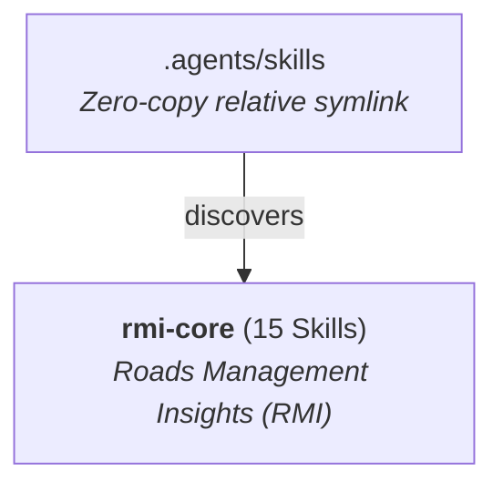

# Roads Management Insights (RMI) Agentic Plugins Catalog

This directory hosts modular, multi-platform Agent Plugins for **Google Maps Platform — Roads Management Insights (RMI)**, adhering to the open [Agent Plugins Specification](https://agent-plugins.org/) and compatible with **Antigravity**, **Claude Code**, and **OpenAI Codex CLI**.

---

## 🧭 Available Plugins (1)



| Plugin ID | Stage | Version | Skills | Description |
| :--- | :---: | :---: | :---: | :--- |
| **[`rmi-core`](./rmi-core/README.md)** | **GA** | `2026.11.13` | `15` | Curated suite of agentic skills for Roads Management Insights (RMI) development, APIs, data analytics, and operational runbooks. |

---

## 🚀 Installation Instructions

### 1. Default Repository Clone Discovery (Zero-Copy GA Core)

When you clone this repository and open `roads_management_insights/`, `.agents/skills` is a relative symlink (`../plugins/rmi-core/skills`) that automatically activates all **15 GA Core skills**.

> **Note for Windows Users:** `.agents/skills` is a symlink. Windows users should run `git config core.symlinks true` before cloning (requires Windows Developer Mode), or install the plugin directly using the commands below.

### 2. Installing via Agent Plugin CLIs

#### `rmi-core`

- **Antigravity**:
  ```bash
  # From a local clone of insights-samples:
  agy plugin install ./roads_management_insights/plugins/rmi-core
  # Remote GitHub tree URL (untested):
  agy plugin install https://github.com/googlemaps-samples/insights-samples/tree/main/roads_management_insights/plugins/rmi-core
  ```
- **Claude Code**:
  ```bash
  claude --plugin-dir ./roads_management_insights/plugins/rmi-core
  ```
- **OpenAI Codex CLI**:
  Copy or symlink `./roads_management_insights/plugins/rmi-core` into your Codex plugins directory.

