# Roads Management Insights (RMI) (`rmi-core`)

> **Plugin ID**: `rmi-core` | **Version**: `2026.11.13`

## Overview

Curated suite of agentic skills for Roads Management Insights (RMI) development, APIs, data analytics, and operational runbooks.

Built on the open [Agent Plugins specification](https://agent-plugins.org/), this plugin packages **15 self-contained Agent Skills** (with all transitive skill dependencies verified and co-bundled) into a single portable unit compatible with **Antigravity**, **Claude Code**, and **Codex CLI**.

---

## 🗺️ Architectural Dependency Graph

> **Status**: Current State

```mermaid
graph TD
  %% Status: Current State
  %% Convention: Strict Dependency (A --> B means A depends on / requires B)
  %% Legend: Bold Red (==>) = Explicit Hard Dependency | Dotted Gray (-.->) = Functional/Schema Dependency
  %% Plugin: Roads Management Insights (RMI) (rmi-core)

  subgraph tier_analytics ["4. Analytics & Visualization"]
    RMI_DATAAGENT_HELPER["rmi-dataagent-helper<br/><i>Conversational Data Agent Grounding</i>"]
    RMI_DATAVIZ["rmi-dataviz<br/><i>Deck.gl, Looker Studio & CARTO Viz</i>"]
    RMI_SQL["rmi-sql<br/><i>36 Multi-Persona Queries & Notebooks</i>"]
  end

  subgraph tier_operations ["3. Route Setting & Datasets"]
    RMI_ROUTESETTING["rmi-routesetting<br/><i>Route Registration & Snapping</i>"]
    RMI_SAMPLEDATASETS["rmi-sampledatasets<br/><i>10-Region Analytics Hub Datasets</i>"]
  end

  subgraph tier_specs ["2. RMI Specifications"]
    RMI_DATA_FOUNDATION_BIGQUERY["rmi-data-foundation-bigquery<br/><i>historical_travel_time & routes_status Schema</i>"]
    RMI_DATA_REALTIME_BIGQUERY["rmi-data-realtime-bigquery<br/><i>recent_roads_data (SRI Buffer Schema)</i>"]
    RMI_DATA_REALTIME_PUBSUB["rmi-data-realtime-pubsub<br/><i>Pub/Sub Stream Schema</i>"]
  end

  subgraph tier_foundation ["1. APIs & Core Foundations"]
    API_ANALYTICSHUB["api-analyticshub<br/><i>Analytics Hub Client</i>"]
    API_GEMINIDATAANALYTICS["api-geminidataanalytics<br/><i>Gemini Data Analytics API</i>"]
    API_ROADS_V1["api-roads-v1<br/><i>Roads API (v1 Snap & Nearest)</i>"]
    API_ROADSSELECTION["api-roadsselection<br/><i>Roads Selection API</i>"]
    API_ROUTES["api-routes<br/><i>Routes API (v2 Compute Routes)</i>"]
    BIGQUERY_GEOSPATIAL["bigquery-geospatial<br/><i>GIS & ST_ Functions</i>"]
    BIGQUERY_PRACTICES["bigquery-practices<br/><i>Partition Pruning & Best Practices</i>"]
  end

  %% EXPLICIT HARD DEPENDENCIES (Bold Red Arrows ==>)
  BIGQUERY_GEOSPATIAL ==>|HARD DEP: BigQuery Standards| BIGQUERY_PRACTICES
  RMI_DATAAGENT_HELPER ==>|HARD DEP: Declared Prerequisite| API_GEMINIDATAANALYTICS
  RMI_DATAAGENT_HELPER ==>|HARD DEP: SQL Analytics| RMI_SQL
  RMI_ROUTESETTING ==>|HARD DEP: Route Selection| API_ROADSSELECTION
  RMI_ROUTESETTING ==>|HARD DEP: Snap to Roads| API_ROADS_V1
  RMI_ROUTESETTING ==>|HARD DEP: Routes v2 Engine| API_ROUTES
  RMI_SAMPLEDATASETS ==>|HARD DEP: Exchange Client| API_ANALYTICSHUB
  RMI_SAMPLEDATASETS ==>|HARD DEP: BigQuery Standards| BIGQUERY_PRACTICES
  RMI_SQL ==>|HARD DEP: Spatial GIS| BIGQUERY_GEOSPATIAL
  RMI_SQL ==>|HARD DEP: BigQuery Standards| BIGQUERY_PRACTICES
  RMI_SQL ==>|HARD DEP: Warehouse Schema| RMI_DATA_FOUNDATION_BIGQUERY
  RMI_SQL ==>|HARD DEP: Real-time SRI Schema| RMI_DATA_REALTIME_BIGQUERY
  RMI_SQL ==>|HARD DEP: Sample Datasets| RMI_SAMPLEDATASETS

  %% FUNCTIONAL / SCHEMA DEPENDENCIES (Dotted Gray Arrows -.->)
  RMI_DATAVIZ -.->|reads SRI speeds| RMI_DATA_REALTIME_BIGQUERY
  RMI_DATAVIZ -.->|reads route geometries| RMI_ROUTESETTING
  RMI_DATAVIZ -.->|reads analytical layers| RMI_SQL
  RMI_DATA_FOUNDATION_BIGQUERY -.->|applies partition design| BIGQUERY_PRACTICES
  RMI_DATA_REALTIME_BIGQUERY -.->|applies buffer retention| BIGQUERY_PRACTICES
  RMI_DATA_REALTIME_BIGQUERY -.->|receives stream messages| RMI_DATA_REALTIME_PUBSUB
  RMI_ROUTESETTING -.->|provisions routes_status| RMI_DATA_FOUNDATION_BIGQUERY
  RMI_SAMPLEDATASETS -.->|implements table schema| RMI_DATA_FOUNDATION_BIGQUERY
  RMI_SAMPLEDATASETS -.->|implements table schema| RMI_DATA_REALTIME_BIGQUERY
  RMI_SQL -.->|queries stream schema| RMI_DATA_REALTIME_PUBSUB

  %% Tier Styling
  classDef tier_foundation fill:#e8f0fe,stroke:#1a73e8,stroke-width:2px,color:#174ea6;
  classDef tier_specs fill:#f3e8fd,stroke:#7b1fa2,stroke-width:2px,color:#4a148c;
  classDef tier_operations fill:#e6f4ea,stroke:#137333,stroke-width:2px,color:#0d652d;
  classDef tier_analytics fill:#fef7e0,stroke:#b06000,stroke-width:2px,color:#8a3b00;
  classDef tier_apps fill:#fce8e6,stroke:#c5221f,stroke-width:2px,color:#a50e0e;

  class RMI_SQL,RMI_DATAAGENT_HELPER,RMI_DATAVIZ tier_analytics;
  class RMI_ROUTESETTING,RMI_SAMPLEDATASETS tier_operations;
  class RMI_DATA_FOUNDATION_BIGQUERY,RMI_DATA_REALTIME_BIGQUERY,RMI_DATA_REALTIME_PUBSUB tier_specs;
  class API_ANALYTICSHUB,API_GEMINIDATAANALYTICS,API_ROADSSELECTION,API_ROADS_V1,API_ROUTES,BIGQUERY_GEOSPATIAL,BIGQUERY_PRACTICES tier_foundation;

  %% Edge Prominence Styling
  linkStyle 0,1,2,3,4,5,6,7,8,9,10,11,12 stroke:#b31412,stroke-width:3.5px;
  linkStyle 13,14,15,16,17,18,19,20,21,22 stroke:#80868b,stroke-width:1.2px,stroke-dasharray: 4 4;
```



---

## 🚀 Installation & Setup

### Method 1: Antigravity Plugin

Install from a local clone of this repository (or symlink into `~/.gemini/config/plugins/rmi-core` or `.agents/plugins/rmi-core`):

```bash
agy plugin install ./roads_management_insights/plugins/rmi-core
# Remote GitHub tree URL (untested):
# agy plugin install https://github.com/googlemaps-samples/insights-samples/tree/main/roads_management_insights/plugins/rmi-core
```

### Method 2: Claude Code Plugin

Load the plugin directory from a local clone of this repository:

```bash
claude --plugin-dir /path/to/rmi-core
```

### Method 3: Codex CLI Plugin

Copy or symlink `rmi-core` into your Codex plugins directory (recognizes `.codex-plugin/plugin.json`).

### Method 4: Using the `skills` CLI (`npx skills` / `skills.sh`)

Point the command at a single plugin folder, not at `roads_management_insights/`. A product-level URL also picks up skills from other plugins and sample apps.

```bash
# GA core (untested):
npx skills add https://github.com/googlemaps-samples/insights-samples/tree/main/roads_management_insights/plugins/rmi-core
```

If your project is allowlisted for an RMI Preview feature, run the same command for that Preview plugin's folder (`plugins/rmi-preview-<feature>`).

---

## 💬 Suggested Starter Prompts

- *"Register a monitored SelectedRoute using Routes API v2 and the Roads Selection API"*
- *"Query historical travel time reliability and recurring congestion bottlenecks in BigQuery"*
- *"Provision a Gemini Data Analytics agent grounded with RMI golden SQL queries"*

---

## 📦 Bundled Skills Catalog

<!-- BEGIN_SKILLS_TABLE -->
| Skill | Description |
| :--- | :--- |
| **[`api-analyticshub`](./skills/api-analyticshub/SKILL.md)** | Expert guidance on BigQuery Analytics Hub. Use this skill when the user asks about shared datasets, linked datasets, data exchange, subscribing to listings, discovering public datasets, or querying tables with privacy policies like AGGREGATION_THRESHOLD. Also handles resource management (CRUD operations) for Exchanges, Listings, and Subscriptions. Make sure to use this skill whenever the user mentions Analytics Hub, data sharing exchanges, creating listings, public datasets exchange, or subscribing to linked datasets.  |
| **[`api-geminidataanalytics`](./skills/api-geminidataanalytics/SKILL.md)** | Expert guidance, tools, and clients for the Google Cloud Gemini Data Analytics API (GA v1, with v1beta and v1alpha support). Use to perform conversational data analysis, translate natural language into executable SQL, manage multi-turn conversation states, and configure Data Agents with BigQuery data sources.  |
| **[`api-roads-v1`](./skills/api-roads-v1/SKILL.md)** | Use this skill for the legacy Google Maps Roads API (v1). It provides procedural knowledge for 'Snap to Roads' and 'Nearest Roads'—essential for cleaning GPS traces before RMI route submission. Make sure to use this skill whenever the user mentions legacy roads, snapping GPS points, or finding the nearest physical road segments to raw coordinates.  |
| **[`api-roadsselection`](./skills/api-roadsselection/SKILL.md)** | Developer guide, reference clients (Python, TypeScript, Go, Rust, POSIX Bash; RoadsSelectionClient), and examples for the Google Maps Platform Roads Selection API (roads.googleapis.com/selection/v1). Use when creating, registering, updating, patch with updateMask, listing, or deleting SelectedRoute resources, configuring dynamicRouting or selectedRouteId, running BatchCreate (up to 1,000 routes), BatchUpdate, or BatchDelete, managing routeAttributes, inspecting STATE_RUNNING or STATE_INVALID states, or diagnosing VALIDATION_ERROR_ROUTE_OUTSIDE_JURISDICTION and route validation errors. Do not use for turn-by-turn directions or ComputeRoutes pathfinding (use api-routes), legacy Roads API v1 snapToRoads or nearestRoads (use api-roads-v1), Road Network API v2 roads:list or matchPaths segment lookup (use api-roadnetwork), MATCH_AND_SPLIT_BY_ROAD waypoint sampling strategies (use rmi-routesetting), or BigQuery SQL queries on routes_status and historical_travel_time, Pub/Sub feeds, or Analytics Hub cost estimates (use rmi-sql).  |
| **[`api-routes`](./skills/api-routes/SKILL.md)** | Use this skill for pathfinding, travel time estimation, and distance matrix calculations. Essential for understanding how RMI snaps waypoints to the road network using the Routes v2 engine. Make sure to use this skill whenever the user mentions Routes API v2, route calculation, travel duration, distance matrices, or directions pathfinding.  |
| **[`bigquery-geospatial`](./skills/bigquery-geospatial/SKILL.md)** | Expert guidance on BigQuery Geospatial (GIS) capabilities. Use this skill when the user asks about GEOGRAPHY types, spatial functions (ST_*), proximity analysis, spatial joins, or spatial indexing (S2/H3/Quadbin) in BigQuery.  |
| **[`bigquery-practices`](./skills/bigquery-practices/SKILL.md)** | Use this skill for foundational BigQuery best practices for SQL performance, geospatial functions, temporal engineering, BQML, vector search, storage optimization (physical vs. logical), execution diagnostics, and enterprise governance.  |
| **[`rmi-data-foundation-bigquery`](./skills/rmi-data-foundation-bigquery/SKILL.md)** | Use this skill for querying and analyzing the foundational RMI (Roads Management Insights) BigQuery datasets, specifically route status (routes_status) and long-term/historical traffic duration metrics (historical_travel_time). Activate when querying RMI historical datasets, managing route registration definitions, or reviewing base schema designs.  |
| **[`rmi-data-realtime-bigquery`](./skills/rmi-data-realtime-bigquery/SKILL.md)** | Use this skill for near real-time traffic analysis using the recent_roads_data table. This is a superset of the foundation data, enabling granular Speed Reading Interval (SRI) analysis, offset-based traffic density, road closure auditing, and 60-day rolling performance audits.  |
| **[`rmi-data-realtime-pubsub`](./skills/rmi-data-realtime-pubsub/SKILL.md)** | Use this skill for technical details about the RMI Real-Time Pub/Sub stream, including message schema (Protobuf), key fields (SRIs, travel_duration), linear speed offsets, and integration patterns for live traffic operations.  |
| **[`rmi-dataagent-helper`](./skills/rmi-dataagent-helper/SKILL.md)** | Use this skill for use this skill to configure, optimize, and ground BigQuery Conversational Data Agents for RMI. When invoked, helps users select a persona profile (TOM, Urban Planner, BQ Admin, Data Engineer, Data Scientist, or RMI Planner) to receive tailored grounding mantras, glossary definitions, and verified golden queries.  |
| **[`rmi-dataviz`](./skills/rmi-dataviz/SKILL.md)** | Use this skill for best practices and procedural guidelines for designing high-performance, reactive, and visually stunning map visualizations with Deck.gl and Google Maps.  |
| **[`rmi-routesetting`](./skills/rmi-routesetting/SKILL.md)** | Use this skill when discussing, explaining, or implementing RMI route setting, route setting strategies, selected route setting strategies, route registration strategies, or route selection. It provides foundational strategies (SINGLE_ROUTE_UNIFORM_INTERMEDIATES, SIMPLE_ORIGIN_DESTINATION, MATCH_AND_SPLIT_BY_ROAD, BUS_ROUTE_MONITORING, BYO_POLYLINE) for transforming geographical intent into monitored SelectedRoute objects using GA-stage Routes API, Roads API (v1), and Roads Selection API. Do not use for Road Network API v2 or topology-aware graph partitioning (use rmi-routesetting-preview instead).  |
| **[`rmi-sampledatasets`](./skills/rmi-sampledatasets/SKILL.md)** | Specialized guidance for discovering, subscribing to, and working with Roads Management Insights (RMI) public sample datasets across global metropolitan areas (Boston, Paris, Tokyo, Detroit, Manhattan, Rome, Singapore, Sydney, Buenos Aires, São Paulo State). Use when Gemini CLI needs to list available datasets from Analytics Hub via api-analyticshub, validate queries against sample data, estimate production costs based on sample baselines, or ensure correct temporal filtering for static snapshots.  |
| **[`rmi-sql`](./skills/rmi-sql/SKILL.md)** | Use this skill for RMI-specific SQL design, including SRI analysis, route metadata parsing, bottleneck detection, and complex traffic metrics. This is the expert guide for writing high-quality queries against RMI BigQuery datasets.  |
<!-- END_SKILLS_TABLE -->
